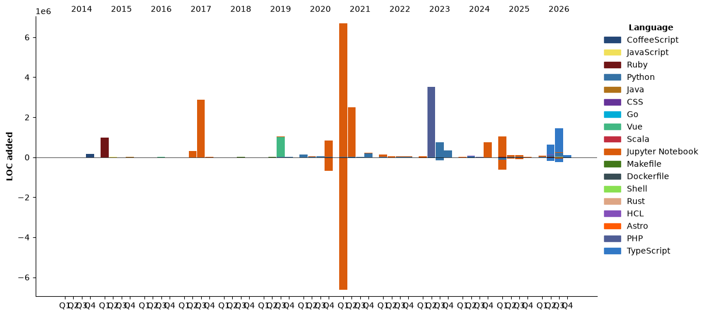

[](https://wakatime.com/@ddf27f94-292a-4343-b7eb-1143a4c6cf87)

[](https://speakerdeck.com/chck)
[](https://www.linkedin.com/in/chck/)

[](https://wakatime.com/@chck?rank=me)

[](https://github.com/anuraghazra/github-readme-stats)

<details>
  <summary><b>Read more</b></summary>
  <br>

  <!--START_SECTION:waka-->


**🐱 My GitHub Data** 

> 📦 312.7 kB Used in GitHub's Storage 
 > 
> 🏆 3,479 Contributions in the Year 2026
 > 
> 💼 Opted to Hire
 > 
> 📜 136 Public Repositories 
 > 
> 🔑 29 Private Repositories 
 > 
**I'm a Night 🦉** 

```text
🌞 Morning                6895 commits        ██████░░░░░░░░░░░░░░░░░░░   23.76 % 
🌆 Daytime                6860 commits        ██████░░░░░░░░░░░░░░░░░░░   23.64 % 
🌃 Evening                7004 commits        ██████░░░░░░░░░░░░░░░░░░░   24.14 % 
🌙 Night                  8258 commits        ███████░░░░░░░░░░░░░░░░░░   28.46 % 
```
📅 **I'm Most Productive on Wednesday** 

```text
Monday                   3612 commits        ███░░░░░░░░░░░░░░░░░░░░░░   12.45 % 
Tuesday                  4701 commits        ████░░░░░░░░░░░░░░░░░░░░░   16.20 % 
Wednesday                5495 commits        █████░░░░░░░░░░░░░░░░░░░░   18.94 % 
Thursday                 4111 commits        ████░░░░░░░░░░░░░░░░░░░░░   14.17 % 
Friday                   3801 commits        ███░░░░░░░░░░░░░░░░░░░░░░   13.10 % 
Saturday                 4095 commits        ████░░░░░░░░░░░░░░░░░░░░░   14.11 % 
Sunday                   3202 commits        ███░░░░░░░░░░░░░░░░░░░░░░   11.03 % 
```


📊 **This Week I Spent My Time On** 

```text
💬 Programming Languages: 
Other                    45 hrs 3 mins       ████████████████████████░   94.67 % 
Markdown                 1 hr 15 mins        █░░░░░░░░░░░░░░░░░░░░░░░░   02.66 % 
Python                   32 mins             ░░░░░░░░░░░░░░░░░░░░░░░░░   01.12 % 
Bash                     16 mins             ░░░░░░░░░░░░░░░░░░░░░░░░░   00.59 % 
TeX                      6 mins              ░░░░░░░░░░░░░░░░░░░░░░░░░   00.24 % 

🔥 Editors: 
Chrome                   31 hrs 3 mins       ████████████████░░░░░░░░░   65.26 % 
Claude Code              16 hrs 15 mins      █████████░░░░░░░░░░░░░░░░   34.18 % 
Neovim                   10 mins             ░░░░░░░░░░░░░░░░░░░░░░░░░   00.35 % 
Obsidian                 5 mins              ░░░░░░░░░░░░░░░░░░░░░░░░░   00.21 % 
```

🤖 **AI Coding This Week** 

```text
⏱ AI Coding Time: 16 hrs 18 mins (34.26%)

✍️ 2,849 lines written by AI, 0 lines written by hand (100.0% AI-written)

🔤 15,553,984 Input Tokens, 2,109,118 Output Tokens

💵 $96.85 Estimated AI Cost This Week

🧠 448 AI Sessions, 2791 AI Prompts

Sonnet                   2,870 lines         █████████████████████████   100.00 % 
Haiku                    0 lines             ░░░░░░░░░░░░░░░░░░░░░░░░░   00.00 % 
Opus                     0 lines             ░░░░░░░░░░░░░░░░░░░░░░░░░   00.00 % 

🔎 AI Coding Insights:
🤖 AI-Driven — 100.0% of written lines came from AI
📚 Verbose Prompter — average 4,904 characters per prompt
🔁 Iterative Prompter — average 6 prompts per session
🚀 High AI Trust — 0.0% of changed lines were hand-edited
```

**I Mostly Code in Python** 

```text
Python                   56 repos            █████████░░░░░░░░░░░░░░░░   36.13 % 
Jupyter Notebook         25 repos            ████░░░░░░░░░░░░░░░░░░░░░   16.13 % 
JavaScript               13 repos            ██░░░░░░░░░░░░░░░░░░░░░░░   08.39 % 
Rust                     8 repos             █░░░░░░░░░░░░░░░░░░░░░░░░   05.16 % 
TypeScript               7 repos             █░░░░░░░░░░░░░░░░░░░░░░░░   04.52 % 
```


**Timeline**




 Last Updated on 2026-10-25 15:09 UTC
<!--END_SECTION:waka-->
</details>

