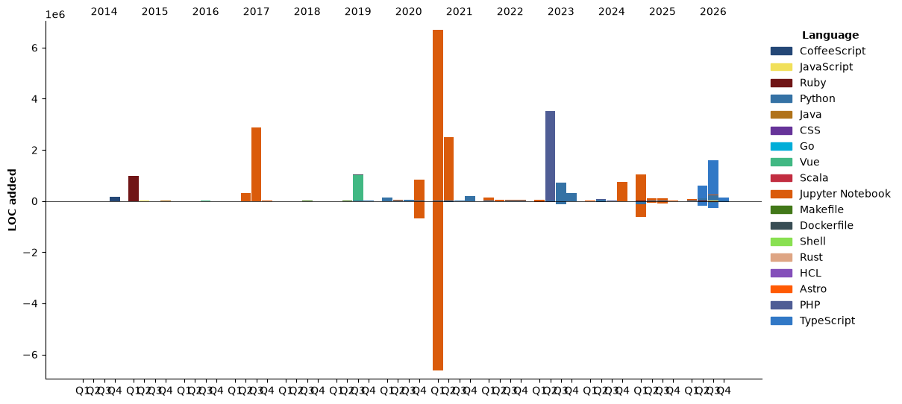

[](https://wakatime.com/@ddf27f94-292a-4343-b7eb-1143a4c6cf87)

[](https://speakerdeck.com/chck)
[](https://www.linkedin.com/in/chck/)

[](https://wakatime.com/@chck?rank=me)

[](https://github.com/anuraghazra/github-readme-stats)

<details>
  <summary><b>Read more</b></summary>
  <br>

  <!--START_SECTION:waka-->


**🐱 My GitHub Data** 

> 📦 ? Used in GitHub's Storage 
 > 
> 🏆 3,762 Contributions in the Year 2026
 > 
> 💼 Opted to Hire
 > 
> 📜 136 Public Repositories 
 > 
> 🔑 0 Private Repositories 
 > 
**I'm a Night 🦉** 

```text
🌞 Morning                4230 commits        █████░░░░░░░░░░░░░░░░░░░░   21.10 % 
🌆 Daytime                5363 commits        ███████░░░░░░░░░░░░░░░░░░   26.75 % 
🌃 Evening                4977 commits        ██████░░░░░░░░░░░░░░░░░░░   24.82 % 
🌙 Night                  5481 commits        ███████░░░░░░░░░░░░░░░░░░   27.34 % 
```
📅 **I'm Most Productive on Thursday** 

```text
Monday                   2752 commits        ███░░░░░░░░░░░░░░░░░░░░░░   13.73 % 
Tuesday                  3198 commits        ████░░░░░░░░░░░░░░░░░░░░░   15.95 % 
Wednesday                3375 commits        ████░░░░░░░░░░░░░░░░░░░░░   16.83 % 
Thursday                 3413 commits        ████░░░░░░░░░░░░░░░░░░░░░   17.02 % 
Friday                   2625 commits        ███░░░░░░░░░░░░░░░░░░░░░░   13.09 % 
Saturday                 2246 commits        ███░░░░░░░░░░░░░░░░░░░░░░   11.20 % 
Sunday                   2442 commits        ███░░░░░░░░░░░░░░░░░░░░░░   12.18 % 
```


📊 **This Week I Spent My Time On** 

```text
💬 Programming Languages: 
Other                    20 hrs 54 mins      █████████████████░░░░░░░░   68.55 % 
Markdown                 6 hrs 34 mins       █████░░░░░░░░░░░░░░░░░░░░   21.56 % 
TeX                      1 hr 35 mins        █░░░░░░░░░░░░░░░░░░░░░░░░   05.23 % 
Bash                     18 mins             ░░░░░░░░░░░░░░░░░░░░░░░░░   01.01 % 
Text                     16 mins             ░░░░░░░░░░░░░░░░░░░░░░░░░   00.91 % 

🔥 Editors: 
Chrome                   18 hrs 23 mins      ███████████████░░░░░░░░░░   60.27 % 
Claude Code              8 hrs 16 mins       ███████░░░░░░░░░░░░░░░░░░   27.14 % 
Codex CLI                3 hrs 16 mins       ███░░░░░░░░░░░░░░░░░░░░░░   10.74 % 
Obsidian                 15 mins             ░░░░░░░░░░░░░░░░░░░░░░░░░   00.82 % 
Zed                      11 mins             ░░░░░░░░░░░░░░░░░░░░░░░░░   00.65 % 
```

🤖 **AI Coding This Week** 

```text
⏱ AI Coding Time: 11 hrs 39 mins (38.23%)

✍️ 1,226 lines written by AI, 167 lines written by hand (88.01% AI-written)

🔤 7,064,453 Input Tokens, 971,274 Output Tokens

💵 $65.23 Estimated AI Cost This Week

🧠 157 AI Sessions, 477 AI Prompts

Sonnet                   991 lines           █████████████████░░░░░░░░   69.40 % 
GPT                      432 lines           ████████░░░░░░░░░░░░░░░░░   30.25 % 
Gemini                   5 lines             ░░░░░░░░░░░░░░░░░░░░░░░░░   00.35 % 
Haiku                    0 lines             ░░░░░░░░░░░░░░░░░░░░░░░░░   00.00 % 

🔎 AI Coding Insights:
🤖 AI-Driven — 88.01% of written lines came from AI
📚 Verbose Prompter — average 6,834 characters per prompt
🔁 Iterative Prompter — average 3 prompts per session
🚀 High AI Trust — 10.54% of changed lines were hand-edited
```

**I Mostly Code in Python** 

```text
Python                   44 repos            █████████░░░░░░░░░░░░░░░░   37.29 % 
Jupyter Notebook         18 repos            ████░░░░░░░░░░░░░░░░░░░░░   15.25 % 
Dockerfile               3 repos             █░░░░░░░░░░░░░░░░░░░░░░░░   02.54 % 
HCL                      2 repos             ░░░░░░░░░░░░░░░░░░░░░░░░░   01.69 % 
Astro                    1 repo              ░░░░░░░░░░░░░░░░░░░░░░░░░   00.85 % 
```


**Timeline**




 Last Updated on 2026-11-21 07:05 UTC
<!--END_SECTION:waka-->
</details>

